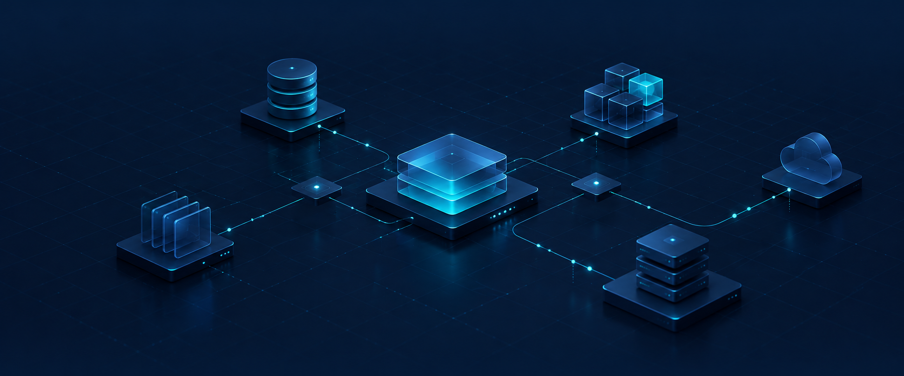
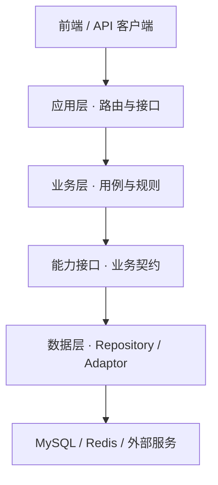
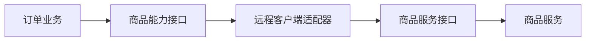

<div align="center">



# backend-skill

**让后端架构有清晰的边界，让功能扩展有明确的契约。**

一个面向 Go 后端的 AI Skill，帮助你从代码理解、分层设计到前后端对接与微服务演进，建立可追踪的架构决策。

[](https://go.dev/)


[快速开始](#快速开始) · [设计理念](#设计理念) · [使用场景](#使用场景) · [技能内容](#技能内容) · [参考项目](#参考项目)

</div>

---

## 什么是 backend-skill？

`backend-skill` 是一套供 AI 助手使用的后端工程指引。它关注的不只是目录分层，还包括：**层与层之间如何通过接口协作、一个功能扩展会影响哪些契约，以及前端如何可靠地调用后端。**

适合用来：

- 阅读一个 Go 项目，梳理对象构造、接口依赖和请求链路。
- 设计或扩展业务功能，明确各层职责和兼容性。
- 编写前后端接口契约，规划联调与错误处理。
- 在需要时，将模块化单体逐步演进为微服务。

> 这是一个 **AI Skill**，不是 Go 框架、商城代码或可直接运行的微服务项目。具体项目的代码、接口文档与部署方案，需要结合实际需求生成和验证。

## 设计理念

### 分层是起点，契约让变化可控



| 层次 | 主要职责 | 扩展时关注的问题 |
| :--- | :--- | :--- |
| **应用层** | 请求绑定、身份获取、响应与错误映射 | 前端接口是否兼容？ |
| **业务层** | 业务规则、流程编排、用例边界 | 规则是否集中、依赖是否清晰？ |
| **接口契约** | 定义能力、输入输出、错误与行为语义 | 可以替换什么？新增方法会影响谁？ |
| **Adaptor / 数据层** | 实现数据库、缓存和外部服务访问 | 实现变化是否满足原有契约？ |

分析已有项目时，skill 会区分**职责分离、代码依赖、运行时调用和对象装配**。它会先解释已实现的解耦价值，再说明具体耦合与扩展限制，不把接口的存在等同于完全可替换。

### 从本地调用到服务调用

当业务边界和独立部署需求足够明确时，能力接口可以成为演进的连接点：



这里的接口表达业务需要，远程客户端负责协议和错误转换。跨网络后，超时、重试、幂等和数据一致性需要额外设计；Go 接口本身不会自动提供这些能力。

## 快速开始

### 1 · 安装

将本仓库克隆到 AI 助手读取技能的目录中，并命名为 `backend-skill`。例如，使用 Codex 的个人技能目录：

```bash
mkdir -p ~/.codex/skills
git clone https://github.com/malevrigns/backend-skill.git ~/.codex/skills/backend-skill
```

如果已安装同名技能，请先比较现有内容，避免覆盖已有修改。其他支持 `SKILL.md` 的工具，请按其技能目录约定安装。

### 2 · 在任务中调用

```text
使用 $backend-skill 分析这个 Go 项目：
说明应用层、业务层和数据层如何解耦，
画出依赖装配和一次请求的完整调用链。
```

也可以将需求描述得更具体，例如：

```text
使用 $backend-skill 为后台用户增加分页查询。
请列出各层改动、接口契约、前端对接文档和验证方式。
```

### 3 · 审阅并验证结果

Skill 会根据任务引导助手读取项目、分析边界、实现功能或提供方案。请结合实际代码检查输出；涉及接口、数据库、并发或分布式行为时，使用项目测试和联调结果验证。

## 使用场景

<table>
<tr>
<td width="50%" valign="top">

### 01 / 理解已有架构

梳理 `IAdaptor`、Repository 接口、构造函数和具体实现。区分对象如何创建与请求如何流转，追踪 DTO、DO 和数据库模型之间的数据变化。

</td>
<td width="50%" valign="top">

### 02 / 扩展业务功能

明确新功能的输入输出、错误、事务和并发语义，列出应用层、业务层、接口、实现与装配各自需要修改的内容。

</td>
</tr>
<tr>
<td valign="top">

### 03 / 对接前端

为接口提供方法、路径、鉴权、字段、响应、错误码和示例；在功能实现中交付 OpenAPI 契约，并说明 Mock、类型生成与联调方式。

</td>
<td valign="top">

### 04 / 演进为微服务

按业务能力识别服务边界和数据归属，将本地能力接口映射到客户端适配器与服务端接口，并规划迁移、一致性和回滚。

</td>
</tr>
</table>

## 一次功能扩展会得到什么？

以**新增管理员分页查询**为例，skill 会引导助手沿着契约检查：

1. **应用层**：定义查询参数、权限和返回结构，注册接口。
2. **业务层**：组织查询用例，明确可见范围和业务规则。
3. **数据契约**：约定过滤、稳定排序、分页、总数和错误语义。
4. **数据实现**：通过 Repository 与 GORM 查询，实现约定的行为。
5. **对接与验证**：提供接口文档、示例和前端联调说明，检查相关实现及测试替身。

> 示例用于说明工作方式，不表示参考项目已经提供该功能。向已有 Go 接口添加方法会影响所有实现者；是否拆分接口，应根据实际消费者和扩展需要决定。

## 技能内容

| 文件 | 作用 |
| :--- | :--- |
| [`SKILL.md`](SKILL.md) | 技能入口：分析、实现和交付流程 |
| [分层设计](references/layered-design.md) | 三层职责、依赖关系与参考案例 |
| [功能扩展契约](references/extension-contracts.md) | 扩展流程、变更影响和具体示例 |
| [前端与 API 契约](references/frontend-api-contracts.md) | 接口文档、鉴权、错误、Mock 和联调 |
| [微服务演进](references/microservice-evolution.md) | 服务边界、通信、数据一致性与迁移 |

## 参考项目

设计讨论参考了 [yuanqinguo/flyfei 中的 mall 项目](https://github.com/yuanqinguo/flyfei/tree/master/src/golang/project/backend/mall)，特别是其中的 adaptor、接口和分层结构。参考说明是分析快照，使用时应重新核对项目实际代码。

README 的信息组织参考了 [Awesome README](https://github.com/matiassingers/awesome-readme) 收录的项目示例。

---

<div align="center">

**Design the boundaries. Define the contracts. Build for change.**

[查看技能入口](SKILL.md) · [提出 Issue](https://github.com/malevrigns/backend-skill/issues)

</div>
